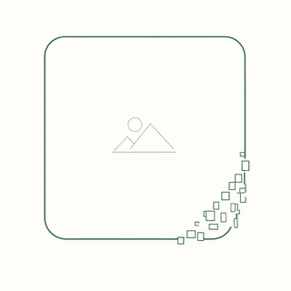

<div align="center">
  
  <h1>ScreenshotBye</h1>
  <p>截图常常只是临时用一下，用完就忘在相册里。这个应用持续在后台留意相册，过一段时间问你一句「这张截图还要吗」，回答不需要就删掉它——默认那条路删掉之后进的是系统相册自己的回收站，反悔可以在相册里还原；
    嫌系统弹窗烦可以开「无感删除」跳过确认，代价是少了一次点头的机会，能不能还原本应用说不准（见下文）。</p>
  <p>
    
    
    
    
    
  </p>
</div>

---

## 一次询问会发生什么

1. 引导页走完、在设置页打开**启用服务**，之后每次开机它都会自己在后台跑起来（常驻前台服务 + 开机自启 + 定时自动恢复）。
2. 你截了一张图。系统把它写进相册并通知 MediaStore，`ContentObserver` 收到变化，350ms 防抖后按 `DATE_ADDED` 水位线做一次增量查询，用「所在目录 / 文件名」两条规则判断这是不是截图。
3. 是截图 → 记进待确认清单，并用 WorkManager 排一个 N 分钟后的一次性任务（默认 5 分钟，档位 2／5／15／30／90）。任务持久化在 WorkManager 数据库里，进程被杀、设备重启都照样会到点。
4. 到点 → **通知栏只出现一条**提醒。连截十张也合并成一条「10 张截图还要吗？」，不会刷屏；同一条通知会按节流规则重新出声（见「提醒方式与自检」）。
5. 点通知进入逐个确认页：一张一张看，三个选择——从左到右固定 `保留` / `稍后` / `删除`，左右滑动切换。看完进入反选屏，勾着的这批一次处理。这一页和主页一样不进系统最近任务，处理完就走。
6. 整批共用**一次系统弹窗**：Android 11+ 发的是 MediaStore 的回收站请求，你在系统框里点确认之后，原件进的是系统相册自带的回收站——保留多久、怎么显示、能不能还原，全由系统和相册决定，本应用不再复制原件、不再存副本，卸载应用也带不走你的照片。
   嫌这一次弹窗烦，可以在设置页开**无感删除**（即「所有文件访问」）跳过确认。省下的只有弹窗，原件去向仍由系统定，而**这个去向三方应用查不到**：原生安卓这样删是真删；有的 ROM 会把那一行标成 `is_trashed=1`（这种查得到）；更多国产 ROM 把文件直接挪进 `DCIM/.globalTrash` 这类不被媒体库索引的目录——行没了、原路径也空了，跟真删在应用侧长得一模一样。所以界面只承诺「不弹确认」，绝不替你断言进不进回收站，名字后面的感叹号把这件事说清楚。
7. Android 10 及以下没有这套机制：那一版由应用直接删除，删掉就找不回来了。
8. 一直没回答的询问默认不会永远挂着：超过设定天数（默认 3 天）自动按「保留」出队；这一档设成 0 就是「继续等待处理」，条目一直留在队列里。

> 通知上也有快捷按钮，直接处理最早到期那一张，不用点开应用。三颗的顺序和页面一致——`保留` / `稍后` / `删除`，
> 队列里不止一张时中间那颗换成 `全部稍后`，把整批往后推 10 分钟。
> 常驻的后台检查通知在有待确认截图时会变成入口：点它直接进逐个确认页，不用再从主页找按钮。

## 界面

页面分成三层，首页只回答「现在能不能正常干活」：

- **首页**（照参考仓库 MainScreen 一比一摆）：顶部一条应用名，下面居中标题、一句应用简介、一行运行状态，
  然后两个整宽按钮——`请求权限`（缺什么一次问齐，授予后变成 `权限已授予` 并按住）与 `设置`；
  下面是电池优化提示卡（仅在系统还没放行时出现，带一个跳转按钮）与自启动提示卡（常驻，只有说明文字、没有按钮）。
  权限不再逐行罗列说明，授予状态只由那一个按钮体现。
- **设置页**（四块，照参考仓库的分卡）：启用服务 → 识别规则、待确认截图与「无感删除」 → 询问与提醒（四个旋钮）
  → 主题颜色、使用引导、事件日志、运行自检与关于。「待确认截图」是一行可点条目，不再套一层卡片。
- **二级页面**：待确认截图（逐个确认）、使用引导、事件日志、运行自检、关于。

主题配色只作用于按钮、旋钮等控件（`colorPrimary` 那一层）；页面、卡片、文字、分隔线走一套中性色阶，五套配色共用（`res/values/colors_neutral.xml`），换主题不会连字体颜色一起换——和参考仓库一致。

删除默认只有一条路：系统相册的回收站（Android 10 及以下没有回收站）。想少一次系统弹窗，
设置页第二卡有一行 `无感删除`，跳去系统页面手动授予 `MANAGE_EXTERNAL_STORAGE`，此后删除当场生效、不再弹确认框。
它省下的是**弹窗**，仅此而已。原件去哪了应用查不到——「媒体库里那一行没了」既可能是真删，
也可能是系统把文件挪进了相册也索引不到的隐藏回收站目录，两种情况在应用侧完全同形。
所以行尾只有 `未授予` / `已开启 · 不弹确认` 两态，绝不写「直接删除」也绝不写「进回收站」；
唯一敢说的是删完那一行还在、并且被系统标成 `is_trashed=1` 的时候。名字后面的感叹号写清代价，
不授就维持默认的系统弹窗。

可调项全是**固定档位吸附旋钮**：可选值本来就三五个，摊成一圈数字，
怎么滑都只会停在格子之一，切档时「咔」一下短震动。滑块的问题在于「8 分钟」和「12 分钟」
体感没有区别，却让用户在一条连续轨道上猜哪一格才是 15 分钟 —— 所以旧版的六根滑块换成了旋钮，
自定义关键词那一栏也一并去掉了。旋钮没有额外提示文字，也没有跳转系统设置的按钮：
声音、震动、横幅本来就归系统的通知设置管，要调去自检页跳。

深色模式同样不在应用里做开关，跟随系统；五套配色每套都备了亮、暗两份色表，
文字颜色一律走 `?attr/colorOnSurface` / `colorOnSurfaceVariant` / `colorOutline`，
不是硬写的深灰 —— 之前夜间模式有些字看不清就是这个原因。

## 设置项

| 位置 | 设置 | 形式 | 可选值 | 默认 |
| --- | --- | --- | --- | --- |
| 首页 | 请求权限、设置入口 | 按钮 | — | — |
| 设置 ① | 启用服务 | 开关 | — | 开 |
| 设置 ② | 识别规则 | 复选 | 按截图目录 / 按文件名 / 含录屏视频 | 目录 + 文件名 |
| 设置 ② | 待确认截图 | 二级页面（行尾显示待处理张数） | — | — |
| 设置 ② | 无感删除（所有文件访问） | 跳转系统页面；名字后带感叹号，点开是代价说明（仅 Android 11+） | 未授予 / 已开启 · 不弹确认 | 不授予 |
| 设置 ③ | 首次询问 | 旋钮 | 2 / 5 / 15 / 30 / 90 分钟 | 5 |
| 设置 ③ | 默认保留 | 旋钮 | 1 / 3 / 5 / 7 / ∞ 天（∞ 排在最右，存的是 0 = 一直等着不自动出队） | 3 |
| 设置 ③ | 间隔 | 旋钮 | 1 / 2 / 5 / 10 / 20 分钟 | 5 |
| 设置 ③ | 重复 | 旋钮 | 0（不重复）/ 1 / 2 次 | 2 |
| 设置 ④ | 主题颜色 | 色块，点一下当场换色 | 米白 / 青灰 / 陶土 / 靛蓝 / 石墨 | 米白 |
| 设置 ④ | 使用引导 | 二级页面 | 首次启动的分页说明，随时可重看 | — |
| 设置 ④ | 事件日志 | 二级页面 | 复制、清空 | — |
| 设置 ④ | 运行自检 | 二级页面 | 通知/权限/服务/队列状态报告 + 测试提醒，可复制 | — |
| 设置 ④ | 关于 | 二级页面 | 应用名、版本号与说明正文（当前为占位文本） | — |

旧版本存的是 1–60 / 0–120 这类连续值，读到新档位时会自动吸附到最近的一格（平局留下较小的那档），
不需要卸载重装，也不做迁移脚本。

## 提醒方式与自检

「提醒不够强、回来要在通知栏里翻」是 v1.0.2 针对的问题。那一版做了「安静 / 横幅+震动 / 横幅+震动+声音」三档，
v1.0.3 把这个档位**撤掉了**：声音、震动、横幅、锁屏显示本来就归系统的通知设置管，应用再做一层开关只是把同一个设置
复制一遍，还容易和 ROM 自己的开关打架。现在只剩一条「截图待确认」渠道，响不响、震不震由你在系统里定。

- **一条提醒渠道 + 一键直达系统设置**：自检页有 `在系统设置里管理提醒方式`，直接跳到这条渠道的系统页面
  （Android 8 起声音、震动、横幅、锁屏显示都归渠道所有，应用内改不了，也不该改）。
  1.0.2 短暂建过的三条强度渠道在启动时会被删掉，系统设置里不会留下重复项；渠道 id 没变，你在系统里调过的铃声和横幅
  开关仍然生效。
- **会重新出声的询问**：同一条通知默认只在第一次响，后面的截图到期就完全无感。现在按节流规则重发提醒——
  连拍保护 90 秒（几秒内多张一起到期只响一次）、间隔档位 1／2／5／10／20 分钟（默认 5，只管隔多久）、
  次数档位 0／1／2（默认 2，0 = 不重复，问一次之后就只更新通知不再出声）。通知被划掉不等于回答了，
  条目留在队列里并安排一次补提醒（次数为 0 时不补）；`稍后` 会把次数清零。
- **应用内自检页**：设置页 `运行自检` 一份纯文本报告——通知权限、渠道实际 importance、当前勿扰状态、后台检查服务是否活着、
  内容观察器和最近扫描的时间戳、相册水位线是否落后、到点任务的状态、队列里每一条的状态和已提醒次数、
  以及哪些条件正在挡住提醒。`发一条测试提醒` 走真实渠道真发一条，用来区分「应用没发」还是「系统压掉了」。
- **闪退留痕**：应用自己挂了 `Thread.setDefaultUncaughtExceptionHandler`，把最后一条未捕获异常的类名、消息和前六层
  调用栈同步写进偏好（异步写会在进程被杀时丢掉），自检页的 `上次未捕获异常` 直接显示它。没有 adb 也能把堆栈带进反馈里。

## 下载

最新 release：[v1.0.14](https://github.com/ChangAkira/ScreenshotBye/releases/tag/v1.0.14) —
直接安装 [ScreenshotBye-v1.0.14.apk](https://github.com/ChangAkira/ScreenshotBye/releases/download/v1.0.14/ScreenshotBye-v1.0.14.apk)
（release 签名，minSdk 26 / Android 8.0 起）。v1.0.1 起都是同一把密钥，**直接覆盖安装即可**，待确认清单和设置都保留。

v1.0.14 两件事：界面上的「监控」措辞去干净，「默认保留」的 0 档改成 ∞ 挪到最右。

- **不再说「监控」**：常驻通知「正在监控截图」改成「正在检查新截图」，渠道名「监控状态」改成「新截图提醒」，
  首页电池优化 / 自启动卡片、事件日志、自检报告、使用引导里的「监控」「相册监听」「看门狗」一并换成
  「后台检查」「相册变化」「自动恢复」——功能和权限一个字没动，纯粹是措辞。
  引导页里那句「在后台盯着相册」也改成了「留意相册」。加了一条单元测试，反射扫全部 `R.string` 与 `R.array`，
  出现「监控 / 监听 / 看门狗 / 盯着」就红。
- **默认保留的 0 档改成 ∞**：0 的含义一直是「不设到期，没回答的一直等着」，可摆在档位最左边、又写着「0 天后」，
  读起来像「0 天就出队」。现在档位顺序变成 1 / 3 / 5 / 7 / ∞，∞ 排在最右（越往右等得越久），
  圆心读数、弧外数字、读屏描述都画 ∞；`SharedPreferences` 里存的还是 0，`sweepStale()` 的
  `askExpiryDays > 0` 判断照旧，老用户的设置不用迁移、含义不变。自检页那一行也跟着写成「∞：一直等着，不会自动按保留出队」。
  `DetentDial` 因此多了一个 `app:dialInfinityValue` 属性：指定哪个档位值要画成 ∞，其它旋钮不受影响。

v1.0.13 三件事：换主题不再连字体颜色一起换、录屏有封面了、逐个确认页不再跳张。

- **字体颜色不再跟着主题配色走**（这条本来就是 main 上的改动，跟着本版一起发出去）：之前 34 个 Material 角色按配色整表摊开，
  正文色 `colorOnSurface` 在米白下是暖棕 `#5C5247`、靛蓝下是冷蓝 `#3D4063`，换主题看着像连字一起换了。底色和卡片早就中性化了，
  文字没有理由还跟着走。现在每套配色的 style 里只留控件层那 17 个角色（primary / secondary / tertiary / error 及各自容器与前景，
  加 `colorPrimaryInverse`），页面、卡片、各级容器、正文、次要文字、分隔线这 17 个中性角色统一写在 `Theme.ScreenshotBye.Base`，
  取值来自新增的 `colors_neutral.xml`（夜间同名文件），五套配色共用。
  `colors_palettes.xml` 里不再被引用的中性色一并清掉（每套配色 17 条，日、夜两份各删 85 条），少一处「改了没生效」的坑；
  取值与孪生项目 PhotosManager 的 `ui/theme/Palette.kt` 里的 `Neutral` 一一对应，改一处要同步改另一处。
  箭头用的 `outline` 比原先略深一点（`#9B9A97`），因为中性化的容器色比原来的米色阶深一档，原来的浅灰箭头在最深一层卡片上
  只剩 1.8:1 会糊掉；单元测试里那条 1.9:1 的下限现在才真的守住。
- **录屏的预览不再是黑的**：`Thumbs` 只会用 `BitmapFactory` 解字节流，视频解出来是 null，界面就落到深色占位图上，看着像一块黑。
  现在认得 `.../external/video/media/<id>` 这类 URI，直接抽一帧当封面（取 1.5 秒那里，避开片头的黑帧和淡入，取不到再退回首帧），
  只解一张静态图、不做播放。Android 8.x 上没有按尺寸解的接口，就先解整帧再缩。
- **逐个确认页不会再跳张**：两张时把第一张标删除、左滑翻回去改判保留——这张一移出本轮，第二张正好顶到当前格，
  老代码拿「是不是最后一格」当收口条件，于是以为问完了，页面直接收尾，第二张压根没问过。
  现在收口看的是「后面还有没有没答的」，标了删除的那几张不算欠问（它们在反选屏收口，也正是在那儿反悔）。
  翻页规则写进了测试：删完第一张改判保留后，第二张必须还挂在清单里等用户答。

v1.0.12 把 v1.0.11 那句「本机实测去向」也撤了——因为它同样是一句我们没资格说的话：
- **回查那一行分辨不了「进了回收站」**。有用户反馈：手机是会把删除的截图放回回收站的，界面上却写着「直接删除」。
  原因在 ROM 的实现方式：小米这类系统把第三方应用删掉的文件挪进 `DCIM/.globalTrash`（或 `MIUI/Gallery/Cloud/.trashbin`）
  这样的目录，同时**把 MediaStore 那一行整条删掉**，而那些目录不在媒体库索引范围内。于是「真删」和「挪进回收站」
  在应用侧是同一个读数（行没了），v1.0.11 把「行没了」翻译成「直接删除」就是硬猜，猜错了还反过来吓人。
- **界面上从此不写去向**。行尾只剩 `未授予` / `已开启 · 不弹确认` 两态；自检报告的「删除去向」只交代
  「不弹确认框」和「应用查不到去向，要找回只能去相册回收站看」；感叹号那段说明把上面这层原因写全了。
  唯一保留的断言是系统当场认账的那种：行还在且 `is_trashed != 0` → 日志写 `已进回收站：X`。
- **事件日志改成中性措辞**：`已删除：X`；只有查得到 `is_trashed` 才写 `已进回收站：X`。
  另外补一种应用确实能确认的情况——行没了、原路径上文件却还留着（系统只删了索引），
  这种写成 `已删除，相册记录已移除、文件仍留在原目录：X`。
- **顺手去掉一处数据丢失风险**：v1.0.11 之前的静默删除在「行没了」之后还会照着 `DATA` 路径补一次 `File.delete()`。
  既然现在确认了「行没了」很可能意味着文件已被系统搬进它自己的回收站，那一刀就可能把唯一的副本砍掉，因此删掉这段逻辑。

v1.0.11 改掉一处我们说错了的话，换成另一句仍然没资格说的话（「本机实测去向」在 v1.0.12 已撤回）：

- **`删除免确认` 改名 `无感删除`**：原来那个名字描述的是手段（不弹确认框），改名之后描述的是体感。
- **不再断言「不进回收站」**：上一版写死了「授了所有文件访问就是直删、原件不进回收站」。实际不是——
  原生安卓这样删确实是真删，但小米这类系统会把第三方应用的删除照样改投回收站（三星 My Files 的回收站也收别的应用删掉的文件），
  所以那句话在某些机器上是错的。现在删完立刻回头查那一行：行没了记「直接删除」，行还在但 `is_trashed=1`
  记「进回收站」（并且这种情况下绝不补删文件，那会儿原件就是回收站里唯一的副本），行还在又没标记才算删除失败。
  行尾三种取值 `已开启 · 不弹确认` / `已开启 · 直接删除` / `已开启 · 进回收站`，没实测过就老实说没实测过。
- **名字后面加了感叹号**：点开写清「在某些系统上被删除的照片可能不会进入回收站，请谨慎开启」，
  以及为什么这台机器上的结果和别人不一样。整行仍跳系统授权页，感叹号只管说明。
- 自检报告的「删除去向」同步改成跟着实测结果走；事件日志分开写 `已彻底删除：X` 和 `已进回收站：X`。

v1.0.10 是两处顺手的一致性修补：

- **横幅通知上的按钮顺序改成和逐个确认页一样**：上一版页面是 `保留` / `稍后` / `删除`，通知却是
  `删除` / `保留` / `稍后`，两处学一个手势划不来。现在一律从左到右 `保留` · `稍后` · `删除`，
  队列多张时中间那颗仍是 `全部稍后`，位置不动。测试里把布局那一排的文案顺序和通知 action 顺序直接对撞，
  再改反就会红。
- **逐个确认页不再留在系统最近任务里**：补上 `android:excludeFromRecents`，和主页、透明确认页一致——
  它本来就是一次性的处理页，处理完不该还挂在多任务里。

v1.0.9 把「话太多」这件事整体收了一遍，并把删除的取舍交回用户手里：

- **旋钮下方那段缺口不再吃触摸**：上一版只按半径判断环带，而弧只张 240°，正下方 120° 连轨道都没画，
  那一片照样把按下吃掉、页面滑不动。现在同时约束半径和张角，落在那段缺口里一律让给 `NestedScrollView`。
- **少了一半吐司和横幅**：`监控已开启/关闭`、`识别规则已更新`、`日志已清空`、`正在采集`、
  `已发出测试提醒`、`已删除 N 张` 这类「状态本来就在屏幕上」的回执全部去掉；
  系统弹窗确认成功后也不再补一句吐司（只有「有东西没删成」才说）。
  「等待系统确认」那条通知改成不重复出声（`setOnlyAlertOnce`）并降为普通优先级，询问通知的正文去掉说明书式尾巴。
- **新增可选的免确认删除**：设置页第二卡 `删除免确认（所有文件访问）` 跳去系统页面授予 `MANAGE_EXTERNAL_STORAGE`。
  授了之后删除当场生效、不弹系统框；当时行尾写着 `已授予 · 不进回收站`——那是推测。v1.0.11 改成按本机实测写，
  v1.0.12 承认真测不出来，现在只写「不弹确认」。
  不授就还是默认那条「系统弹窗 → 进回收站」的路，Android 10 及以下这一行整个藏掉。
- **重复提醒的语义理顺**：「不重复」以前靠把间隔调成 0 分钟表达，现在归次数那一档——
  间隔档位 1／2／5／10／20 分钟只管隔多久，次数档位 0／1／2 里的 0 就是不重复（档位数量没变，只换了数值）。
- **文案大幅缩短**：`不需要，删除` → `删除`、`还要留着` → `保留`、`10 分钟后再问` → `稍后`、`全部稍后再问` → `全部稍后`、
  `现在处理` → `去处理`，通知正文、首页电池/自启动卡、引导页、自检报告里的长句一并改短。
  测试里加了字数上限，按钮文案超过四个字就红。

v1.0.8 修掉了设置页最后那点别扭，并把文案从代码里全部搬出来：

- **设置页在卡片内的空白处也能上下滑了**：上一版旋钮一按下就吃触摸，而它的可点区域是整个方形包围盒，
  比画出来的圆环大得多，于是卡片里一大片空白都滑不动。现在只有落在圆轨附近（环带内）的按下才归旋钮，
  其余一律不吃，交给 `NestedScrollView` 滚动。
- **页面背景也不再跟随主题颜色**：主题配色只管按钮、旋钮这些控件。首页与设置页的背景统一取一个固定色
  （浅色 `#F6F5F4` / 深色 `#171718`），五套配色共用，状态栏与导航栏同色。
- **新增「关于」页**：设置页 → 运行自检下面一行进入，显示应用名、版本号与说明正文（当前为占位文本）。
- 前三个旋钮的单位改成「分钟后」「天后」，应用描述去掉句末句号。
- **所有界面文案抽到 `strings.xml`**：事件日志、删除失败原因、自检报告全文、通知动作日志、无障碍描述
  都改成带格式参数的字符串资源，源码里不再硬编码中文（只有目录名/文件名匹配规则例外——那是识别数据，
  翻译了就匹配不上）。有一条单元测试会扫源码，防止硬编码回潮。

v1.0.7 继续向参考仓库看齐，并做了一处后台常驻的大改进：

- **不再出现在系统「最近使用的应用」里**：主页 `MainActivity` 加了 `excludeFromRecents`，任务不进多任务列表，
  用户就没法上滑把它划掉，后台检查更不容易被误杀（和参考仓库一致）。
- **卡片背景不再跟随主题颜色**：主题配色只作用于按钮、旋钮等控件；卡片背景固定为一个中性色，五套配色共用。
  之前 Material3 的 Filled 卡默认取 `colorSurfaceContainerHighest`，那一层各配色都带了色温，换主题时卡片会跟着变。
- **首页照参考仓库补上顶部应用名**，并精简文案：应用描述改为「截图一段时间后由你来决定是否删除。」，
  状态小字改为「运行中  N 张待确认」；自启动提示卡去掉跳转按钮，只留说明文字。
- **设置页「待确认截图」改成一行可点条目**，不再是「卡片里再套一个卡片」的别扭结构。
- **回退旋钮的拨动手势阈值检测**：上一版为「让页面能滚」给旋钮加了横向/斜向阈值判定，反而让旋钮手感变差。
  设置页滑不动的真正原因是当时整页压根没做成可滚动，而非旋钮抢触摸；现在页面已在 `NestedScrollView` 里，
  旋钮恢复成按下即响应、按角度吸附。

v1.0.6 修了五个恼人的问题：

- **修好「确认删除却被当成取消」**：之前在系统弹窗里点了确认、图也确实从相册消失，应用却提示「你选择了取消」、
  条目不出队。根因是回收站语义各家 ROM 不一致——直查单条 MediaStore URI 时很多 ROM 仍会返回已回收的行，
  老逻辑只按「查不查得到」判断就误判成取消。现在直接读 `is_trashed` 列：行没了、或已进回收站，都算「离开相册」。
- **主题颜色回到首页也生效**：从设置页改完配色返回，首页只走 `onResume` 不会重建，于是还顶着旧色；
  现在在 `onResume` 比对当前配色，变了就重建本页。
- **改主题色不再把设置页弹回顶部**：`recreate` 会清掉滚动位置，现在存下 `scrollY` 并在重建后接回来。
- **首页照参考仓库一比一重排**：居中一列，标题 / 简介 / 一行状态，两个整宽按钮（请求权限、设置），
  加电池优化卡（仅未放行时出现）与自启动卡（常驻）；逐行的权限说明文字全部删掉。
- **使用引导的栈序修好**：从设置页重看引导，选「跳过 / 开始使用」只 `finish` 回既有主页，不再新压一个 MainActivity。

v1.0.5 继续向参考仓库看齐，全是界面与交互：

- **首页授予权限只用一个按钮**：权限行改成只读展示授予状态，不再逐行配「授权」，缺什么点那一个
  `请求权限` 一次问齐（和参考仓库一致）。
- **设置页第一行是「启用服务」**，独立成一块，和参考仓库的第一块对齐。
- **使用引导从首页挪进设置页**，放在「主题颜色」下方，随时能重看。
- **修好设置页滑不动**：旋钮原来一按下就把触摸抢走，手指落在旋钮上整页都滚不了；现在只有确认是
  「拨」的手势才抢触摸，竖直滑动交还给页面滚动。
- 设置页按参考仓库分成四块：启用服务 / 识别规则与待确认 / 旋钮 / 主题颜色与引导日志。

v1.0.4 做了两件事：页面照参考仓库重排（权限页与设置页分开，可调项改成固定档位吸附旋钮，夜间模式对比度修好），
以及**撤掉应用自建回收站、改为依赖系统相册自己的回收站**，`MANAGE_EXTERNAL_STORAGE` 一并撤掉，
Android 11 及以上的删除一律走系统的「移入回收站」确认框（一批只弹一次）。

⚠️ v1.0.0 的包用的是 debug 签名，和 v1.0.1 起不是同一把密钥，**覆盖安装会失败**，请先卸载旧版再装新版。

⚠️ 改成「依赖系统照片回收站」之后，应用内的回收站页面整个删掉了。如果你手上的版本（≤ v1.0.3）在应用回收站里还留着没还原的截图，那才是你唯一的副本——**先在那个版本里还原出来，再覆盖安装新版**。升级不会主动删那批文件，但新界面再也没有入口能看到它们。

## 权限与真实限制

这个应用要的权限比普通应用多，逐条说清楚为什么：

| 权限 | 用在哪里 | 必需吗 |
| --- | --- | --- |
| 读取相册（`READ_MEDIA_IMAGES`） | 查询新增截图、显示预览 | 必需，不给就什么都看不见 |
| 通知（`POST_NOTIFICATIONS`） | 到点询问、后台检查 | 必需（Android 13+），否则问不出来 |
| 媒体位置（`ACCESS_MEDIA_LOCATION`） | 发起系统回收站／删除确认请求的前置条件 | 必需 |
| 存储写入（Android 10 及以下） | 直删文件 | 该版本区间必需 |
| 忽略电池优化 / 自启动白名单 | 防国产 ROM 杀后台 | 建议，不设就会中断监测 |
| 震动（`VIBRATE`，普通权限） | 旋钮切档时那一下「咔」 | 不需要用户授权，没有震动马达就跳过 |
| 前台服务 `specialUse` | 后台留意相册新增截图 | 必需，只有一条常驻通知 |
| 所有文件访问（`MANAGE_EXTERNAL_STORAGE`） | 无感删除：跳过系统确认弹窗 | **可选**，默认不开；只能用户在系统页面里手动授予 |

「所有文件访问」在 v1.0.4 被撤掉过（当时只有 OEM 预装相册才被允许直接写 `IS_TRASHED`），v1.0.9 又放回来，
但改成了**用户自己选的取舍**：应用不弹窗申请、也不在首页催，只在设置页给一行入口。
授了它，`DeleteGateway` 走静默删除——少的只有一次系统弹窗，仅此而已。原件的去向**应用查不出来**：原生安卓是真删，
有的 ROM 把那一行留着并标上 `is_trashed=1`（只有这种查得到），更多国产 ROM 把文件挪进 `.globalTrash` 这类不被媒体库
索引的目录、同时删掉那一行——「行没了」这一个读数对应两种下场，界面因此一律不谈回收站，只在感叹号里把风险说清。
不授，Android 11+ 一律走系统的「移入回收站」确认框（一批只弹一次）。

Manifest 里没有 `INTERNET` 权限，应用在系统层面就无法联网：图片字节只在「生成预览」时读过一次，录屏也只抽一帧封面，不上传、不做任何内容分析，也没有统计和账号。

## 它是怎么实现的

- **发现截图**：`MediaStore.ContentObserver` 挂在 `MediaStore.Images.Media.EXTERNAL_CONTENT_URI` 上，这是三方应用唯一可靠的全局截图入口。`FileObserver` 只用来提前催一次扫描，不参与判定。服务重启后从水位线续扫，覆盖停摆期间产生的截图；首次启用时把水位线设为当前时刻，不会把历史截图当新截图。
- **计时**：WorkManager 一次性任务（每张一个 `ask-<mediaId>` 的 unique work），而不是 `Handler.postDelayed`——后者的排队任务会随进程一起消失，五分钟后就问不出来了。
- **处置**：`ScreenshotRepository` 是唯一的决策出口，通知按钮、逐个确认页、定时任务都调它，删除逻辑只有一份。
- **删除**：`DeleteGateway` 先问 `Perms.canDeleteSilently`——拿到静默权限（Android 11+ 的「所有文件访问」，或 10 及以下的 WRITE）就直接 `delete`、不弹任何框，然后立刻回头查那一行，但**只用它区分能区分的事**：行还在且 `is_trashed != 0` 是系统认账的软删（`Removed(trashed = true)`）；行没了只算「删掉了」（`Removed(trashed = false)`），去向标成未知——真删与被挪进不被索引的回收站目录是同一个读数，所以既不补删文件（万一路径还被系统自己的回收站指着，那一刀毁掉的就是唯一副本），也不在界面上写去向；行还在又没标记才算删除没生效；拿不到时 Android 11+ 只生成 `MediaStore.createTrashRequest`（回收站不支持时退回 `createDeleteRequest`），由透明中转页 `DeleteConfirmActivity` 拉起，一批一次弹窗。弹窗结束后核对「这张图是否已离开相册」：直接读 `is_trashed` 列——行查不到了（彻底删除）、或 `is_trashed != 0`（已进回收站）都算离开相册，只有行还在且未回收才算用户点了取消。之所以不靠「集合查询过滤」那一套：直查单条 URI 时很多 ROM 仍会返回已回收的行，会把成功的删除误判成取消。
- **不再自建回收站**：以前是 `filesDir/trash/` 里存一份原件副本 + `meta.json`，再配还原、过期清理任务和一整页 UI。系统从 Android 11 起已经有这个能力了，应用再存一份只是重复，还会占私有空间、让人误以为能自定义保留天数。现在保留期和还原入口都归系统相册，而且用户在相册里点还原时动的是同一条 MediaStore 记录（同一个 `_ID`），「还原后又被当成新截图问一遍」靠原有的 seen 集合就挡住了，不需要额外屏蔽名单。
- **存活**：`BootReceiver`（开机 / 应用更新）+ 15 分钟 `WatchdogWorker`，拉不起来时发一条「点按恢复」的通知，而不是无声失败。
- **队列卫生**：看门狗每轮先跑一次 `sweepStale()` 兜住三种「静默卡住」——`WAITING` 早过了到期时间却没被问（定时任务被 ROM 清掉）→ 立即补问；`ASKED` 超过设定天数没人回答 → 按保留出队；`DELETING` 六小时拿不到系统确认结果（弹窗开着时进程被杀）→ 退回待确认。监控关着时看门狗不在，`MainActivity.onResume` 是兜底入口。
- **提醒的出声时机**：`ScreenshotRepository` 区分 `refreshReviewNotification`（允许按节流规则重新出声）和 `updateReviewNotification`（只同步内容）。到点询问、看门狗心跳、通知被划掉后的补提醒走前者；用户在应用里自己点了保留/删除/稍后再问之后的同步走后者，不该再响一次。
- **不替系统做提醒决定**：询问通知只用一条渠道，`setOnlyAlertOnce(false)` 让同一个 id 能重新出声，声音、震动、横幅一律不写死。渠道属性在创建后不可改，所以早期版本里想「换一档」只能换渠道——这正是三档强度被撤掉的原因。
- **不让启动路径炸**：`Application.onCreate` 里的渠道创建和看门狗排期都包在 `runCatching` 里，失败只往事件日志写一行；权限探测 `Environment.isExternalStorageManager()` 同样兜住异常，一个探测不该带走主界面。两处 `FileObserver(File, int)` / `RecoverableSecurityException` 是 API 29 才有的，minSdk 26 上直接引用会让 Android 8/9 在启动监听、删除时抛 `NoSuchMethodError`——现在改用 `FileObserver(String, int)` 构造和按类名判断异常。

## 为什么不是别的做法

- **Android 14 的 `DETECT_SCREEN_CAPTURE` / `Activity.onScreenCapture()`**：只在你自己的 Activity 可见时回调，而且不返回截图文件，做不了全局截图清理。
- **亮屏广播（`ACTION_SCREEN_ON`）触发**：能弹界面，但不是「截图后 N 分钟」的语义，服务停摆期间的截图也永远补不回来。
- **自建回收站**（≤ v1.0.3 的做法）：能自定义保留天数、卸载前能一键还原，但代价是每删一张就在私有目录里多存一份原件，还原会生成一条新的 MediaStore 记录（相册里出现重名条目），还得再养一个清理任务和一整页 UI。Android 11 起 `MediaStore.createTrashRequest()` 已经把「进系统回收站」这条路开给三方应用了，代价只是每批多一次系统确认弹窗——相比之下不值得再自己存副本，所以整个换掉了。

## 已知限制

诚实列一下，都能在代码里对应上：

- 服务被杀到被拉回之间产生的截图会在下次启动时补扫，但询问时间会顺延。
- Doze 深睡时 WorkManager 的询问可能延后到下一个维护窗口，不是精确到秒。
- 其他应用改名保存的截图可能识别不到：判定只看目录和文件名两条规则，自定义关键词那一栏已经去掉。
- 通知上的快捷按钮只作用于最早到期的那一张，批量操作要点开逐个确认页。
- 删除能否进系统回收站、在里面留多久、相册里怎么展示，全部由 ROM 决定：Google 相册一般是 30 天（开备份 60 天），个别国产 ROM 的相册不读 `IS_TRASHED`，那删掉的截图就没有找回入口。Android 10 及以下没有系统回收站，删掉即消失。
- 开「无感删除」之后原件进不进回收站，**看系统，而且应用测不出来**：原生安卓直接抹掉，有的 ROM 留下 `is_trashed=1` 的行（这种查得到），
  小米这类把文件挪进 `.globalTrash` 那种媒体库不索引的目录并删掉行——此时相册里也许还能还原，应用却只看到「行没了」，
  跟真删一模一样。所以这一项界面上不谈去向，别把「没写进回收站」听成「肯定找不回来」；想要确定有反悔余地的那条路就别开，让它走系统弹窗。
- 旧版本（≤ v1.0.3）留在私有目录里的备份不再有任何界面入口，需要的话请在旧版本里先还原。
- 国产 ROM 的后台管控是硬限制，不手动放行自启动就可能收不到询问。提醒方式也有天花板：应用只负责发通知，
  横幅到底弹不弹、锁屏上显不显示、震动和铃声认不认，最终由 ROM 决定，改只能去系统的通知设置里改。
  用自检页 + 测试提醒可以先确认是哪种情况。
- 询问过期是**按「保留」出队**，不会自动删除——宁可漏删，也不在你不在场时误删。
- 界面文案硬编码中文（包括自检报告正文），未做国际化。
- 验证手段：`gradle testDebugUnitTest` 用 Robolectric 真跑一遍启动路径（主界面、Android 8 上的监控服务、渠道创建、
  询问通知构建、旧版存档兼容、队列卫生、提醒封顶、闪退记录），`gradle lintDebug` 的全量 lint 会揪出
  `lintVitalRelease` 不管的 `NewApi`——两处 Android 8/9 崩溃就是这么发现的。**依然没有在真机上做系统化回归**，
  沙箱里没有 `/dev/kvm`，跑不了模拟器；Robolectric 只能证明「代码能跑完且不抛」，ROM 的推送、铃声、横幅策略仍测不到。

## 从源码构建

环境：JDK 17+、Android SDK Platform 35、AGP 8.7.3 / Gradle 8.10（wrapper 已配置）。依赖版本统一放在 `gradle/libs.versions.toml`。

```bash
# 调试包，无需签名材料
./gradlew assembleDebug
# 产物：app/build/outputs/apk/debug/app-debug.apk

# 启动路径的单元测试（Robolectric，不需要模拟器或真机）
./gradlew testDebugUnitTest
# 报告：app/build/reports/tests/testDebugUnitTest/index.html

# 全量 lint：会报出 release 打包时被跳过的 NewApi
./gradlew lintDebug
```

发布包需要签名材料。`keystore/` 与 `keystore.properties` 已被 `.gitignore` 排除，需自行放置到仓库根目录：

```properties
# keystore.properties
storeFile=keystore/screenshotbye-release.jks
storePassword=<你的密钥库口令>
keyAlias=screenshotbye-release
keyPassword=<你的密钥口令>
```

```bash
./gradlew assembleRelease
# 产物：app/build/outputs/apk/release/app-release.apk
```

没有 `keystore.properties` 时构建依然会通过，只是 release 包不签名、无法直接安装。

## 签名

- 密钥别名：`screenshotbye-release`，RSA 2048，2026-10-31 起有效至 2056-10-23
- 证书 SHA-256：`31:70:EF:6B:D6:70:5A:15:B0:A1:B9:A7:6B:4A:F8:72:7F:4F:BA:25:8C:96:3E:49:F0:A1:30:3A:85:0E:97:00`
- 密钥库文件与口令不入库，由项目所有者单独保管
- 从 v1.0.1 起所有 release 使用同一把密钥；换密钥意味着老用户必须卸载重装

## 代码结构

```
app/src/main/java/com/changakira/screenshotbye/
  core/        Settings(配置 + 闪退记录), PendingShot(待确认清单), Reminders(计时), ScreenshotRepository(决策中枢)
  media/       MediaScanner(发现), ScreenshotRule(判定), DeleteGateway(交给系统的回收站请求)
  service/     WatchService(常驻前台服务), WatchdogWorker(存活看门狗)
  remind/      ReminderWorker(到点询问), AlertRetryWorker(被划掉后补提醒)
  notify/      Channels(常驻 + 一条提醒渠道，顺带清理已废弃的强度渠道), Notify, ActionReceiver(通知按钮与划掉事件)
  diagnostic/  Diagnostics(纯文本自检报告 + 测试提醒)
  perm/        Perms(权限状态、OEM 跳转、直达通知渠道设置)
  ui/          MainActivity(首页：一个授权按钮 + 设置入口), SettingsActivity(设置四段), ReviewActivity(逐个确认+批量反选),
               LogActivity, DiagnosticsActivity, OnboardingActivity(首次引导),
               DeleteConfirmActivity(系统删除确认中转), Adapters, Thumbs,
               ThemedActivity(在 super.onCreate 前 setTheme), theme/Palette(五套配色), widget/DetentDial(固定档位旋钮)
app/src/main/res/ values/colors_palettes.xml + values-night/colors_palettes.xml(每套配色控件层的亮暗两份色表),
               values/colors_neutral.xml + values-night/colors_neutral.xml(五套共用的中性色阶，取值与 PhotosManager 的 Palette.kt 同步),
               values/themes.xml(中性层只写在 Base，一套配色一个 style、只覆盖控件层), values/bools.xml + values-night/bools.xml(状态栏图标明暗)
app/src/test/java/com/changakira/screenshotbye/
               AppSmokeTest(启动路径、队列、提醒)、UiReflowTest(档位吸附、设置页/日志页真起来、配色在 onCreate 前生效)
```

`DeleteConfirmActivity` 是必需的：Android 11+ 的 `MediaStore.createDeleteRequest` 只能由 Activity 发起，
所以批量删除先落到这个透明中转页，由它拉起一次系统确认框，再把结果回报给 `ScreenshotRepository`。

## 技术栈

Kotlin 2.0.21 · AGP 8.7.3 · Material 3（Views + ViewBinding）· WorkManager 2.10.0 · JUnit 4 + Robolectric 4.13（单元测试）· Room/DataStore/Compose 都没用：状态就是一层 SharedPreferences + 一份 JSON 清单，引入数据库只是给自己加迁移负担。

## English summary

ScreenshotBye keeps an eye on your camera roll for you. When a new screenshot shows up, it waits a configurable delay (5 minutes by default) and then asks — in one merged notification, no matter how many screenshots piled up — whether you still need them. Tap through the cards, keep, snooze, or mark them gone; marked shots are handed to the system in one batch: on Android 11+ the app fires a `MediaStore.createTrashRequest()`, so after the system prompt the original lands in your gallery's own trash — the app no longer keeps a copy of anything.

On Android 11 and later, deleting files the app didn't create requires either the "all files access" grant or a system confirmation dialog; ScreenshotBye backs up first and asks the system once per batch, never silently. Detection uses a `MediaStore` content observer plus a `DATE_ADDED` watermark (Android 14's `DETECT_SCREEN_CAPTURE` only fires for your own visible activity and gives you no file), timing uses WorkManager so it survives process death, and a watchdog plus boot receiver bring the foreground service back when aggressive ROMs kill it.

No `INTERNET` permission at all — photos and settings stay on the device. Requires Android 8.0+. On Android 10 and below there is no system trash, so a delete there is final.

The UI is split the way the reference app splits it: a home screen that mirrors the reference almost one-for-one — an app-name bar on top, a centred title, a one-line description and a status line, then two full-width buttons (a single "request permissions" button that asks for everything missing at once and turns into "permissions granted" once done, plus a "settings" entry), a battery-optimisation card that only shows while the system hasn't whitelisted the app, and an always-on autostart card that is text-only. There are no per-permission description rows any more; grant state lives entirely in that one button. The home task is also marked `excludeFromRecents`, so the app never appears in the system recents list and can't be swiped away — the background watcher is less likely to be killed by accident. The theme colour only drives controls (buttons, knobs); card backgrounds are pinned to one neutral colour shared by all five palettes, so cards no longer tint when you switch palette. The settings screen is four cards — an "enable service" switch, detection rules and pending shots (the pending-shots entry is now a plain tappable row, not a card inside a card), four fixed-detent snapping knobs (ask after 2/5/15/30/90 min, keep for 0/1/3/5/7 days where 0 means "keep waiting", re-alert every 0/1/2/5/10 min, up to 1/2/3 times), then colour palettes, the onboarding guide, the event log and the self-check. Deletion has no settings of its own any more: it goes through the system photo trash. Continuous sliders invite "is 8 minutes different from 12?" — detents remove the question; values saved by older builds snap to the nearest detent on read, so nothing needs migrating. Palettes (beige / slate / terracotta / indigo / graphite) ship a light and a dark colour table each and dark mode simply follows the system, with all text routed through theme attributes so night mode is actually legible.

Asks re-alert instead of firing once and going silent: a 90-second burst guard, a configurable repeat interval and a per-item alert cap, all applied to a single notification channel — sound, vibration, heads-up banner and lock-screen behaviour are owned by the system notification settings, and the app just links straight to them rather than duplicating a switch you can already flip in Android itself. (v1.0.2 tried a three-level "alert intensity" picker backed by three channels; since channel settings are immutable once created, that meant three parallel copies of one system setting, so it's gone — the retired channels get deleted on startup and any ringtone or banner choice you'd already made carries over.) Swiping the notification away schedules a follow-up rather than muting the item forever, unanswered asks expire into "kept" after a configurable number of days, and stuck `DELETING` entries fall back into the queue. A built-in diagnostics screen dumps notification permission and channel importance, DND state, service liveness, observer and scan timestamps, WorkManager job states, per-item queue state and the last uncaught crash (captured synchronously, stack frames and all) as copyable plain text, plus a "send test alert" button that posts through the real channel — useful when the question is whether the app didn't fire or the ROM ate the banner.

## License

[MIT](LICENSE) — 简单说：随便用、随便改、随便闭源再分发，保留版权声明即可，出问题不追究作者。
